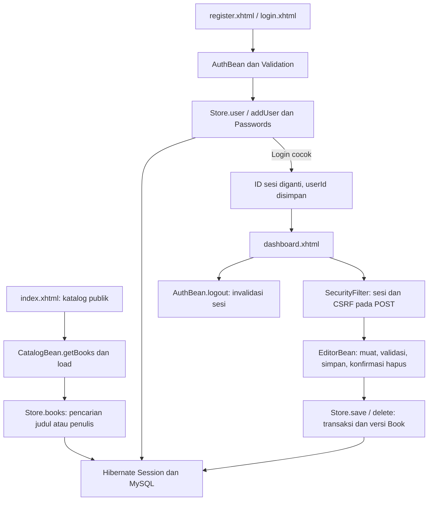

# Alur kode BukaBuku Java

Pengunjung membaca katalog tanpa akun. Setelah mendaftar dan masuk, setiap akun demo dapat mengelola koleksi buku bersama. Buku dan akun disimpan di MySQL melalui Hibernate; tidak ada checkout, peminjaman, atau unduhan isi buku.

## Katalog dan akun

[`CatalogBean`](../src/main/java/id/bukabuku/web/CatalogBean.java) membaca parameter pencarian `q`, membatasi panjangnya, lalu memanggil [`Store.books()`](../src/main/java/id/bukabuku/data/Store.java). Query menggunakan parameter `locate` pada judul/penulis yang sudah dijadikan huruf kecil. Hasil ditampilkan oleh `index.xhtml`; kondisi kosong dibedakan dari kegagalan koneksi.

[`AuthBean.register()`](../src/main/java/id/bukabuku/web/AuthBean.java) memakai `Validation` untuk nama, email, password, dan konfirmasi. Setelah pengecekan email, `Passwords.hash()` menghasilkan hash password; `Store.addUser()` menyimpan akun. Pengguna diarahkan ke login dan tidak otomatis memperoleh sesi login dari registrasi.

`AuthBean.login()` memuat akun berdasarkan email, memverifikasi hash, mengganti ID sesi, lalu menyimpan `userId` dan `userName`. `logout()` membatalkan sesi. Password dan konfirmasi dibersihkan dari field bean setelah permintaan diproses.

## Pemeriksaan request dan pengelolaan

[`SecurityFilter`](../src/main/java/id/bukabuku/security/SecurityFilter.java) menambahkan header respons, membuat token CSRF sesi, dan mengarahkan akses dashboard tanpa `userId` ke login. POST harus membawa `csrfToken` yang cocok; JSF selanjutnya memproses form dan view state-nya. Filter tidak membentuk sistem peran admin: semua akun demo mempunyai hak pada seluruh koleksi.

[`dashboard.xhtml`](../src/main/webapp/dashboard.xhtml) memanggil `EditorBean.open()` melalui view action. Bean memeriksa pengguna, memuat daftar, dan bila ada parameter `edit`, memuat buku untuk form. [`EditorBean.save()`](../src/main/java/id/bukabuku/web/EditorBean.java) memvalidasi judul, penulis, sinopsis, serta tanggal sebelum meneruskan buku ke store.

`confirmDelete()` membuka konfirmasi; `cancelDelete()` membatalkannya. `delete()` baru menghapus setelah buku dipilih dan konfirmasi aktif. Pesan sukses disiapkan setelah operasi store selesai; kegagalan menyimpan/menghapus menampilkan hasil yang belum dapat dikonfirmasi, dengan arahan memuat ulang sebelum mencoba lagi.

## Transaksi, versi, dan koneksi

`Store.transaction()` membuka satu Hibernate Session, memulai transaksi, menjalankan operasi, lalu commit. Jika operasi/commit gagal, rollback dicoba; kegagalan rollback ditambahkan sebagai suppressed exception tanpa menutupi kesalahan awal. Session ditutup pada akhir blok.

[`Book`](../src/main/java/id/bukabuku/model/Book.java) mempunyai `@Version`. Penyimpanan buku yang ada memakai `merge`; versi lama mencegah penimpaan perubahan yang sudah tersimpan. Penghapusan juga memeriksa versi yang sebelumnya dibaca pengguna.

[`Database`](../src/main/java/id/bukabuku/data/Database.java) membuat SessionFactory dari environment dan memvalidasi schema, bukan membuat ulang tabel runtime. Kegagalan koneksi menyebabkan factory yang gagal dibuang; permintaan berikutnya dapat membuat koneksi baru. Operasi tulis yang gagal tidak diputar ulang otomatis. [`AppLifecycle`](../src/main/java/id/bukabuku/web/AppLifecycle.java) menutup factory saat aplikasi berhenti.

[`database/001-schema.sql`](../database/001-schema.sql) menyediakan schema dan metadata contoh untuk database baru. Sampul merupakan aset lokal; penambahan buku melalui form tidak menyediakan upload sampul. Pemulihan password, verifikasi email, audit perubahan, dan pembatasan login tidak termasuk alur ini.
